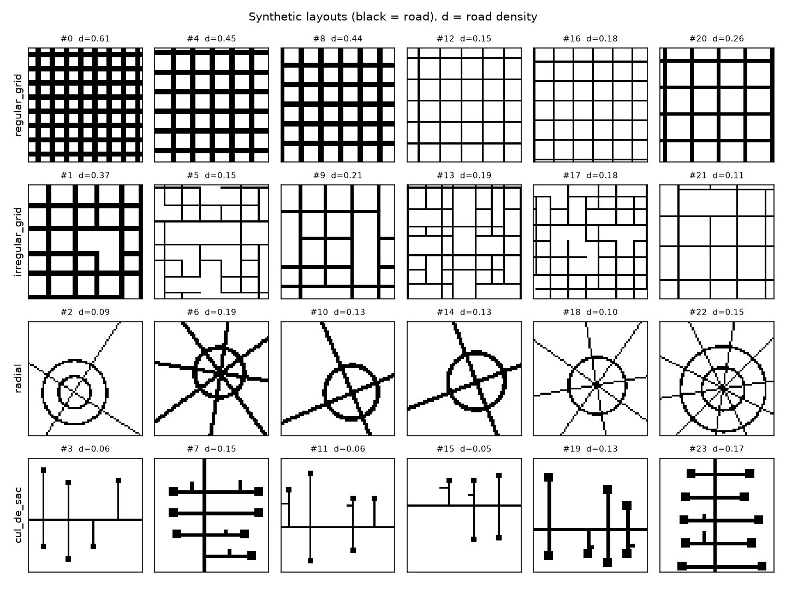
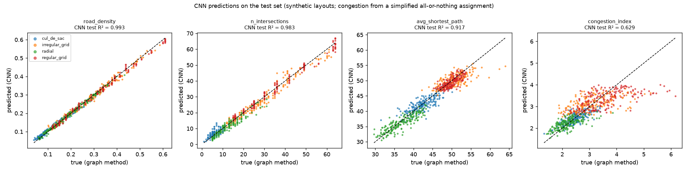

# InverseStreets – Predicting and Generating Road Layouts with Deep Learning

> **Status:** Phase 3 (CNN predictor) done.

## Goal
Predict mobility indicators from small 2D street-grid images, and generate new layouts that reach
target indicators (inverse design). Targets can come from a text request processed by a local LLM
and checked against consistency rules. The predictor is also exported for edge devices.

## Research context
- **Inverse design with deep learning**: property prediction, conditional generation, constraint checking.
- **Smart mobility**: network accessibility, simple traffic assignment, congestion indicators.
- **Embedded AI**: ONNX export, INT8 quantization, latency and size benchmarks.

## Honesty notes
- All layouts are **synthetic**.
- Traffic indicators come from a **simplified all-or-nothing shortest-path assignment**, NOT a
  calibrated traffic simulation.
- Every number in this README comes from running the code in this repository.

## Installation
```bash
python -m venv .venv
# Windows
.venv\Scripts\activate
# Linux / macOS
source .venv/bin/activate
pip install -r requirements.txt
pytest
```

## How to run each phase
**Phase 1 – synthetic dataset**
```bash
python -m src.generate_layouts            # 5,000 layouts, settings in configs/default.yaml
python -m src.generate_layouts --n 200    # quick small run
```
Outputs: `data/layouts.npz` (images), `data/params.csv` (style, generation parameters, split),
`results/example_layouts.png`, `results/dataset_summary.csv`.

**Phase 2 – mobility indicators** (needs Phase 1 data)
```bash
python -m src.build_labels                # all layouts, uses all CPU cores but one
python -m src.build_labels --n 200        # quick small run
```
Outputs: `data/labels.csv`, `results/indicators_by_style.csv`,
`results/indicator_distributions.png`, `results/edge_load_heatmaps.png`.

**Phase 3 – CNN predictor** (needs Phase 2 labels)
```bash
python -m src.predictor                   # 20 epochs, about 3-4 min on a laptop CPU
python -m src.predictor --epochs 2        # quick check
```
Outputs: `models/predictor.pt` (not committed), `results/predictor_metrics.csv`,
`results/predictor_metrics_by_style.csv`, `results/label_repeatability.csv`,
`results/predictor_latency.csv`, `results/predictor_scatter.png`, `results/predictor_training.png`.

## Results
### Phase 1 – dataset
5,000 binary 64x64 images (road = 1), 1,250 per style, seed 42. Generation takes about 18 s on a laptop CPU.
Split (stratified by style): 3,500 train / 752 val / 748 test. All 5,000 road networks are a single
8-connected component.

| Style | Mean road density | Min | Max |
|---|---|---|---|
| regular_grid | 0.310 | 0.121 | 0.609 |
| irregular_grid | 0.275 | 0.089 | 0.594 |
| radial | 0.199 | 0.056 | 0.448 |
| cul_de_sac | 0.137 | 0.035 | 0.327 |



### Phase 2 – mobility indicators
Each image is turned into a road graph: skeletonize the roads, find intersections (3+ branches)
and road ends, trace the roads between them (edge length in pixels), then remove skeleton
artefacts (spurs < 3 px, intersections < 3 px apart are merged). Road ends touching the image
border are **border exits** (the street continues outside the tile), not dead ends.

Traffic: 200 trips per layout, each between two random land (non-road) pixels linked to their
nearest graph node, assigned to the single shortest path (**all-or-nothing**: no capacity, no
congestion feedback, no calibrated demand). This is only a first step towards what tools like
PTV Visum do with calibrated demand, capacities and equilibrium assignment; the traffic numbers
are relative indicators, **not** traffic predictions.

Mean indicators per style (5,000 layouts, computed in about 55 s on 7 CPU workers; lengths in pixels):

| Indicator | cul_de_sac | irregular_grid | radial | regular_grid |
|---|---|---|---|---|
| road density | 0.137 | 0.275 | 0.199 | 0.310 |
| intersections | 6.24 | 29.08 | 12.75 | 32.82 |
| dead ends | 9.22 | 0.18 | 0.00 | 0.00 |
| connectivity | 1.000 | 1.000 | 1.000 | 1.000 |
| avg shortest path | 42.19 | 50.50 | 36.72 | 49.92 |
| detour index | 1.493 | 1.323 | 1.157 | 1.268 |
| avg trip length | 48.07 | 46.49 | 44.41 | 44.88 |
| congestion index (max/mean load) | 2.50 | 3.06 | 2.22 | 3.53 |
| share of congested segments (> 2x mean) | 0.129 | 0.095 | 0.046 | 0.111 |

Checks: for all 1,250 cul-de-sac layouts the detected dead ends equal the generator's
branches + side spurs; no layout has a detour index below 1.


### Phase 3 – CNN predictor (image -> indicators)
A small CNN (4 conv blocks + 2 linear layers, 192,292 parameters) predicts four indicators at
once from the 64x64 image. Targets are standardized with training statistics; training uses
random rotations/flips (they do not change the indicators), Adam, 20 epochs, and keeps the epoch
with the lowest validation loss. Training took 204 s on a laptop CPU.

Test set (748 layouts):

| Indicator | Mean baseline R² | Density-only linear R² | CNN R² | CNN MAE |
|---|---|---|---|---|
| road density | 0.000 | 1.000 (*) | 0.993 | 0.008 |
| intersections | 0.000 | 0.422 | 0.983 | 1.60 |
| avg shortest path (px) | 0.000 | 0.057 | 0.917 | 1.39 |
| congestion index | 0.000 | 0.174 | 0.629 | 0.35 |

(*) The density-only baseline gets road density exactly, since density is its input.

**Label noise ceiling.** Average shortest path and congestion depend on random choices (source
nodes, random trips). Recomputing the test labels with another seed and comparing with the
stored labels gives R² = 0.958 (avg shortest path) and **0.731 (congestion index)**. No
predictor can explain the random part of a label, so these are upper bounds: the CNN reaches
0.917 and 0.629.

CNN R² within each style is lower than overall (e.g. intersections in cul-de-sac layouts:
0.103), because within one style the indicators vary much less; part of the overall R² comes
from telling the styles apart. See `results/predictor_metrics_by_style.csv`.

Inference on CPU (Intel Core, 4 PyTorch threads): 1.56 ms mean / 2.18 ms p95 per single
image after warm-up, 0.98 ms per image in batches of 256.



## Limitations
- Layouts are simple procedural patterns on a 64x64 pixel grid, not real street maps.
- The styles are easy to tell apart, and road density differs strongly between styles.
- Traffic: all-or-nothing assignment with uniform random demand, no capacities, no calibration.
  Trip ends attach to the nearest graph node, so spoke ends at the image border can collect
  extra trips in radial layouts.
- In 3 of 1,250 radial layouts, a very dense centre (thick ring + many spokes) leaves a small
  skeleton artefact counted as one dead end.
- The CNN under-predicts high congestion values (regression towards the mean on a noisy label),
  and much of its overall R² comes from recognising the layout style.
- Connectivity is 1.0 for every layout, because the generator guarantees connected networks; it
  will only become informative for generated layouts (Phase 5).

## Future work
Real OpenStreetMap tiles, calibrated traffic assignment, link with PTV Visum/Vissim,
multi-agent simulation, deployment on an NVIDIA Jetson.
