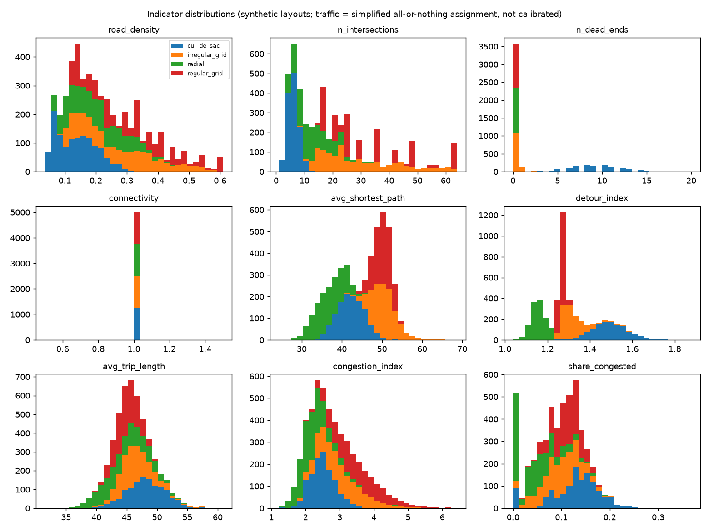
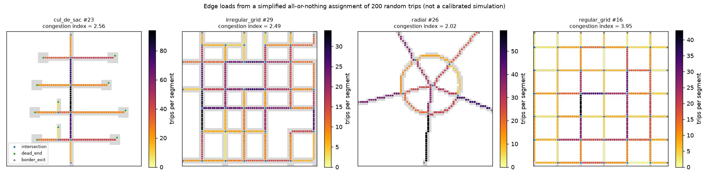
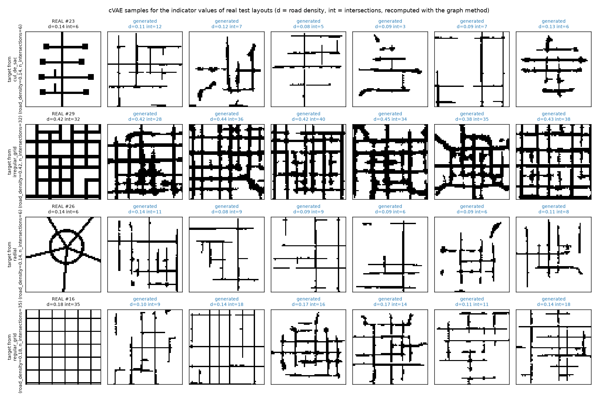
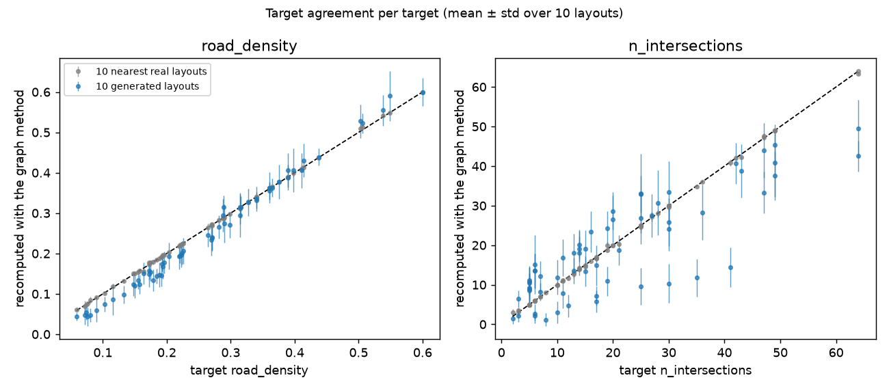
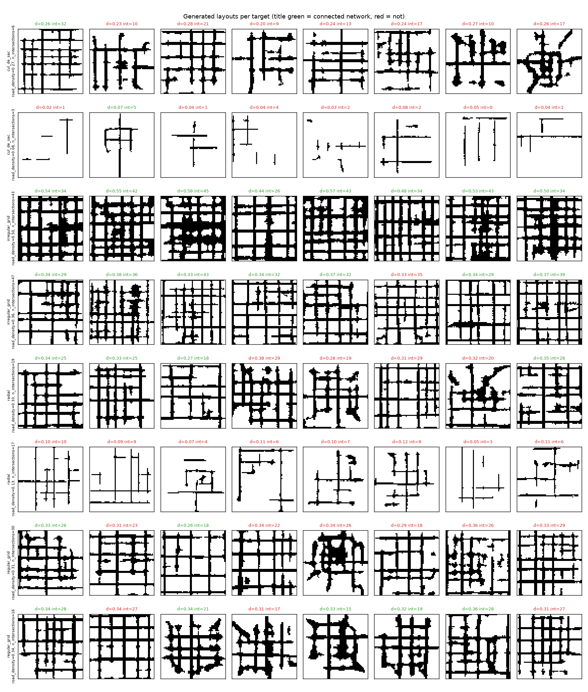
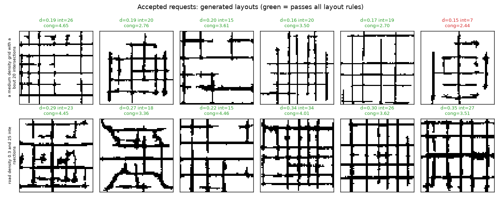
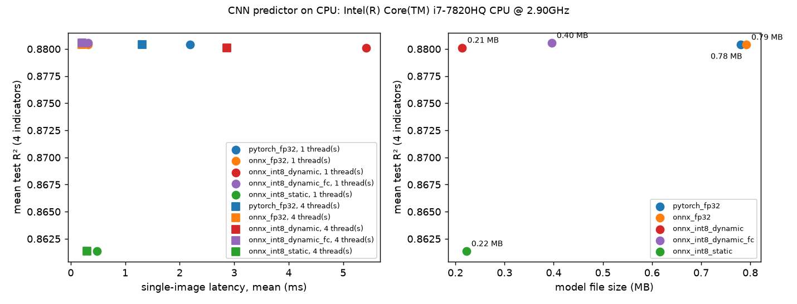

# InverseStreets – Predicting and Generating Road Layouts with Deep Learning

> **Status:** all phases done: dataset, indicators, predictor, generator, evaluation,
> constraints + LLM, edge benchmark, demo.

## Goal
Predict mobility indicators from small 2D street-grid images, and generate new layouts that reach
target indicators (inverse design). Targets can come from a text request processed by a local LLM
and checked against consistency rules. The predictor is also exported for edge devices.

## Research context
- **Inverse design with deep learning**: property prediction, conditional generation, constraint checking.
- **Smart mobility**: network accessibility, simple traffic assignment, congestion indicators.
- **Embedded AI**: ONNX export, INT8 quantization, latency and size benchmarks.

## Honesty notes
- All layouts are **synthetic**.
- Traffic indicators come from a **simplified all-or-nothing shortest-path assignment**, NOT a
  calibrated traffic simulation.
- Every number in this README comes from running the code in this repository.

## Key findings
- **Prediction works, within limits set by the labels.** A 192k-parameter CNN predicts road
  density, intersections and average shortest path with test R² 0.99 / 0.98 / 0.92. Congestion
  reaches 0.63, against a ceiling of 0.73 caused by the randomness of the trips themselves.
- **Generation is the hard part.** A conditional VAE follows the density target (MAE 0.031) but
  intersections only roughly (MAE 7.4), and only 38 % of generated layouts form one connected
  road network. Retrieving the closest real layout beats it on every metric.
- **A learned predictor is not a valid judge of generated layouts.** On generated images the
  CNN's R² for average shortest path falls from 0.92 to 0.19. Generated layouts are therefore
  checked with the graph method.
- **Explicit rules catch inconsistent requests.** A local LLM translates text into JSON without
  repairing contradictions; data-driven rules then reject requests such as "very low road density
  but 40 intersections" with an explanation, before anything is generated.
- **For edge deployment, the runtime and what you quantize matter most.** ONNX Runtime is 7x
  faster than PyTorch here; dynamic INT8 on all layers is 3.7x smaller but 17x slower; INT8 on
  the linear layers only halves the size at the same speed and accuracy.

Details and discussion: [`results/analysis.md`](results/analysis.md).

## Demo
```bash
streamlit run app/streamlit_app.py
```
Three tabs: **Predict** (pick a test layout or upload an image: CNN prediction vs graph method,
edge-load heatmap), **Generate** (target sliders or a text request for the local LLM: rule
checks, then generated layouts with recomputed indicators and a valid / invalid mark),
**Benchmark** (edge results). Needs the data and models from phases 1–4 (see below); the text
request needs Ollama, the rest works without it.

## Repository structure
```
configs/default.yaml     all parameters and seeds
src/generate_layouts.py  synthetic layouts (4 styles)            Phase 1
src/graph_metrics.py     image -> road graph -> indicators        Phase 2
src/traffic.py           random trips + all-or-nothing assignment Phase 2
src/build_labels.py      indicators for the whole dataset         Phase 2
src/dataset.py           splits, target scaling, augmentation     Phase 3
src/predictor.py         CNN predictor + baselines                Phase 3
src/generator.py         conditional VAE                          Phase 4
src/evaluate.py          metrics, evaluation of generated layouts Phase 3, 5
src/constraints.py       consistency rules                        Phase 6
src/llm_spec.py          text request -> JSON -> rules            Phase 6
src/edge_benchmark.py    ONNX, INT8, latency / size               Phase 7
app/streamlit_app.py     demo                                     Phase 8
results/                 metrics (CSV), figures, analysis.md
tests/                   pytest suite (runs offline)
```
`data/` and `models/` are generated locally and not committed.

## Installation
```bash
python -m venv .venv
# Windows
.venv\Scripts\activate
# Linux / macOS
source .venv/bin/activate
pip install -r requirements.txt
pytest
```

## How to run each phase
Full pipeline from scratch on a laptop CPU (about 15 minutes in total, seed 42):
```bash
python -m src.generate_layouts && python -m src.build_labels && python -m src.predictor \
  && python -m src.generator && python -m src.evaluate && python -m src.edge_benchmark
```

**Phase 1 – synthetic dataset**
```bash
python -m src.generate_layouts            # 5,000 layouts, settings in configs/default.yaml
python -m src.generate_layouts --n 200    # quick small run
```
Outputs: `data/layouts.npz` (images), `data/params.csv` (style, generation parameters, split),
`results/example_layouts.png`, `results/dataset_summary.csv`.

**Phase 2 – mobility indicators** (needs Phase 1 data)
```bash
python -m src.build_labels                # all layouts, uses all CPU cores but one
python -m src.build_labels --n 200        # quick small run
```
Outputs: `data/labels.csv`, `results/indicators_by_style.csv`,
`results/indicator_distributions.png`, `results/edge_load_heatmaps.png`.

**Phase 3 – CNN predictor** (needs Phase 2 labels)
```bash
python -m src.predictor                   # 20 epochs, about 3-4 min on a laptop CPU
python -m src.predictor --epochs 2        # quick check
```
Outputs: `models/predictor.pt` (not committed), `results/predictor_metrics.csv`,
`results/predictor_metrics_by_style.csv`, `results/label_repeatability.csv`,
`results/predictor_latency.csv`, `results/predictor_scatter.png`, `results/predictor_training.png`.

**Phase 4 – conditional VAE** (needs Phase 2 labels)
```bash
python -m src.generator                     # train 30 epochs (about 8 min on a laptop CPU)
python -m src.generator --from-checkpoint   # reuse models/generator.pt: recalibrate + figures
```
Outputs: `models/generator.pt` (not committed), `results/generator_training.csv/.png`,
`results/generator_threshold_calibration.csv`, `results/generator_quickcheck.csv`,
`results/generated_examples.png`.

**Phase 5 – evaluation of generated layouts** (needs the trained predictor and generator)
```bash
python -m src.evaluate                      # about 35 s
```
Outputs: `results/generation_metrics.csv`, `generation_per_target.csv`, `generation_by_style.csv`,
`generation_cnn_crosscheck.csv`, `generation_target_agreement.png`, `generation_distributions.png`,
`generated_grid.png`, and the written analysis `results/analysis.md`.

**Phase 6 – constraints and LLM specification** (optional: [Ollama](https://ollama.com) with a
local model, set in `configs/default.yaml` under `llm`)
```bash
python -m src.llm_spec "a sparse suburb with few intersections"
python -m src.llm_spec --examples           # 8 consistent / inconsistent requests
```
Outputs: `results/llm_requests.csv`, `results/llm_request_layouts.png`. `llm.num_gpu: 0` runs
the model on the CPU; on the development laptop the Ollama GPU backend crashed with a CUDA
toolchain error on an older NVIDIA driver.

**Phase 7 – edge benchmark** (needs the trained predictor)
```bash
python -m src.edge_benchmark                # about 1 min
python -m src.edge_benchmark --plot-only    # redraw the chart from the saved CSV
```
Outputs: `models/predictor_*.onnx` (not committed), `results/edge_benchmark.csv`,
`results/edge_benchmark.png`.

## Results
### Phase 1 – dataset
5,000 binary 64x64 images (road = 1), 1,250 per style, seed 42. Generation takes about 18 s on a laptop CPU.
Split (stratified by style): 3,500 train / 752 val / 748 test. All 5,000 road networks are a single
8-connected component.

| Style | Mean road density | Min | Max |
|---|---|---|---|
| regular_grid | 0.310 | 0.121 | 0.609 |
| irregular_grid | 0.275 | 0.089 | 0.594 |
| radial | 0.199 | 0.056 | 0.448 |
| cul_de_sac | 0.137 | 0.035 | 0.327 |


### Phase 2 – mobility indicators
Each image is turned into a road graph: skeletonize the roads, find intersections (3+ branches)
and road ends, trace the roads between them (edge length in pixels), then remove skeleton
artefacts (spurs < 3 px, intersections < 3 px apart are merged). Road ends touching the image
border are **border exits** (the street continues outside the tile), not dead ends.

Traffic: 200 trips per layout, each between two random land (non-road) pixels linked to their
nearest graph node, assigned to the single shortest path (**all-or-nothing**: no capacity, no
congestion feedback, no calibrated demand). This is only a first step towards what tools like
PTV Visum do with calibrated demand, capacities and equilibrium assignment; the traffic numbers
are relative indicators, **not** traffic predictions.

Mean indicators per style (5,000 layouts, computed in about 55 s on 7 CPU workers; lengths in pixels):

| Indicator | cul_de_sac | irregular_grid | radial | regular_grid |
|---|---|---|---|---|
| road density | 0.137 | 0.275 | 0.199 | 0.310 |
| intersections | 6.24 | 29.08 | 12.75 | 32.82 |
| dead ends | 9.22 | 0.18 | 0.00 | 0.00 |
| connectivity | 1.000 | 1.000 | 1.000 | 1.000 |
| avg shortest path | 42.19 | 50.50 | 36.72 | 49.92 |
| detour index | 1.493 | 1.323 | 1.157 | 1.268 |
| avg trip length | 48.07 | 46.49 | 44.41 | 44.88 |
| congestion index (max/mean load) | 2.50 | 3.06 | 2.22 | 3.53 |
| share of congested segments (> 2x mean) | 0.129 | 0.095 | 0.046 | 0.111 |

Checks: for all 1,250 cul-de-sac layouts the detected dead ends equal the generator's
branches + side spurs; no layout has a detour index below 1.




### Phase 3 – CNN predictor (image -> indicators)
A small CNN (4 conv blocks + 2 linear layers, 192,292 parameters) predicts four indicators at
once from the 64x64 image. Targets are standardized with training statistics; training uses
random rotations/flips (they do not change the indicators), Adam, 20 epochs, and keeps the epoch
with the lowest validation loss. Training took 204 s on a laptop CPU.

Test set (748 layouts):

| Indicator | Mean baseline R² | Density-only linear R² | CNN R² | CNN MAE |
|---|---|---|---|---|
| road density | 0.000 | 1.000 (*) | 0.993 | 0.008 |
| intersections | 0.000 | 0.422 | 0.983 | 1.60 |
| avg shortest path (px) | 0.000 | 0.057 | 0.917 | 1.39 |
| congestion index | 0.000 | 0.174 | 0.629 | 0.35 |

(*) The density-only baseline gets road density exactly, since density is its input.

**Label noise ceiling.** Average shortest path and congestion depend on random choices (source
nodes, random trips). Recomputing the test labels with another seed and comparing with the
stored labels gives R² = 0.958 (avg shortest path) and **0.731 (congestion index)**. No
predictor can explain the random part of a label, so these are upper bounds: the CNN reaches
0.917 and 0.629.

CNN R² within each style is lower than overall (e.g. intersections in cul-de-sac layouts:
0.103), because within one style the indicators vary much less; part of the overall R² comes
from telling the styles apart. See `results/predictor_metrics_by_style.csv`.

Inference on CPU (Intel Core i7-7820HQ, 4 PyTorch threads): 1.56 ms mean / 2.18 ms p95 per single
image after warm-up, 0.98 ms per image in batches of 256.


### Phase 4 – conditional generation (target indicators -> layout)
A **conditional VAE** (1,467,905 parameters, latent size 32). The encoder sees a layout and its
target values (road density, number of intersections) and compresses the layout into a latent
vector z; the decoder rebuilds the layout from z and the targets. A KL term (weight rising from
0 to 1 over the first 5 epochs) pushes z towards N(0, I), so new layouts are made by drawing
z ~ N(0, I) and decoding it with chosen targets. Trained 30 epochs in 467 s on a laptop CPU
(validation loss was still decreasing).

Post-processing: threshold the road probabilities, remove road fragments of <= 10 pixels,
fill holes of <= 4 pixels. With a 0.5 threshold, thin roads broke apart (the model spreads
probability over neighbouring pixels when unsure of a road's exact position), and generated
density was too low. The threshold is therefore **chosen on validation targets** by density
match: 0.4 (`results/generator_threshold_calibration.csv`).

Quick check on 100 test targets, one sample each, indicators recomputed with the graph method
(`results/generator_quickcheck.csv`; full evaluation in Phase 5):

| | Mean absolute error vs target | Note |
|---|---|---|
| road density | 0.032 | target mean 0.234 |
| intersections | 9.12 | the mean predictor of Phase 3 has MAE 12.5 |
| connected road network | 34% of samples | real layouts: 100% |



### Phase 5 – evaluation of generated layouts
60 targets (15 real test layouts per style) x 10 generated layouts = 600 layouts, all
indicators recomputed with the graph method. Reference: the 10 real training layouts closest to
each target. Full discussion in [`results/analysis.md`](results/analysis.md).

| Metric | Generated | Nearest 10 real |
|---|---|---|
| road density MAE / median relative error | 0.031 / 10.6 % | 0.003 / 1.0 % |
| intersections MAE / median relative error | 7.42 / 37.9 % | 0.28 / 0.0 % |
| connected road network | 38.3 % | 100 % |
| no small isolated fragments | 45.0 % | 100 % |
| realistic road width (1.0–3.0 px, from real data) | 99.0 % | 99.8 % |
| mean pairwise pixel difference (diversity) | 0.325 | 0.339 |
| Wasserstein distance to real test layouts, dead ends | 7.30 | 0.12 |

CNN predictor on generated layouts vs graph method (R²): density 0.986, intersections 0.861,
avg shortest path 0.187, congestion index 0.123 (on real test layouts: 0.993, 0.983, 0.917,
0.629). The learned predictor is not a reliable judge of generated layouts.

(The Phase 4 quick check used 100 other targets with one sample each, so its numbers differ.)




### Phase 6 – constraints and LLM specification
`src/constraints.py` checks a target **before** generation, each rule with a pass/fail message:
road density in [0.10, 0.60]; intersections inside the 1st–99th percentile range of training
layouts with similar density; at least 5 training layouts close to the (density, intersections)
combination; if a maximum congestion index is requested, at least one similar training layout
must reach it. After generation, each layout is checked with the graph method: density in range,
connectivity >= 0.95, congestion below the requested maximum. Except for the fixed density
range, all limits are measured on the training data.

`src/llm_spec.py` sends the request to a **local LLM through Ollama** (here `qwen3.5:4b`, CPU
only), forces a JSON answer, validates it with a JSON schema, then applies the rules. The
prompt gives the LLM the dataset ranges and tells it to copy numbers exactly and **not** to
repair inconsistencies. Tests use a mocked LLM and run offline.

Eight example requests (`results/llm_requests.csv`), 16–35 s per request on CPU:

| Request | LLM JSON (density, intersections, max congestion) | Decision | Failed rules |
|---|---|---|---|
| a dense neighbourhood with many intersections and little congestion | 0.41, 64, 1.22 | reject | intersections vs density; congestion not reachable (lowest similar 3.15) |
| a sparse suburb with few intersections | 0.09, 5, – | reject | density below 0.10 |
| a medium density grid with about 20 intersections | 0.20, 20, – | accept | – (5 of 20 generated layouts pass the layout rules) |
| road density 0.3 and 25 intersections | 0.30, 25, – | accept | – (13 of 20 generated layouts pass) |
| very low road density but 40 intersections | 0.09, 40, – | reject | density range; intersections vs density; combination never seen |
| road density 0.05 with 3 intersections | 0.05, 3, – | reject | density range |
| a very dense city with almost no intersections | 0.61, 2, – | reject | density range; intersections vs density; combination never seen |
| road density 0.4 with 35 intersections and a congestion index below 1.3 | 0.40, 35, 1.3 | reject | congestion not reachable (lowest similar 2.49) |

The LLM copied every explicit number and did not repair the contradictory requests. The
decision matched my expectation for 6 of 8 requests. The two differences are informative:
the LLM maps "many" / "little" to the dataset **extremes**, which makes the plan's own example
request unreachable; and "sparse" maps to 0.09, below the fixed limit of 0.10, although 12.4 %
of the training layouts (mostly cul-de-sacs) have a density below 0.10.



### Phase 7 – edge efficiency
The CNN predictor is exported to ONNX (FP32) and quantized to INT8 with onnxruntime. Besides
the dynamic INT8 quantization from the project plan, two variants are compared: dynamic INT8 on
the linear layers only, and static INT8 (QDQ, per-channel, calibrated on 256 training images).
Device: Intel Core i7-7820HQ (2017 laptop CPU), onnxruntime 1.32, 748 test images, latency
after 50 warm-up runs (`results/edge_benchmark.csv`):

| Version | Size (MB) | Latency mean / p95, 1 thread (ms) | Latency mean, 4 threads (ms) | Mean R² | R² intersections |
|---|---|---|---|---|---|
| PyTorch FP32 | 0.781 | 2.186 / 2.823 | 1.312 | 0.8804 | 0.9826 |
| ONNX FP32 | 0.792 | 0.317 / 0.382 | 0.211 | 0.8804 | 0.9826 |
| ONNX INT8 dynamic (all layers) | 0.214 | 5.421 / 6.061 | 2.869 | 0.8801 | 0.9817 |
| ONNX INT8 dynamic (linear layers only) | 0.396 | 0.321 / 0.372 | 0.208 | 0.8805 | 0.9827 |
| ONNX INT8 static | 0.222 | 0.478 / 0.600 | 0.296 | 0.8614 | 0.9507 |

- ONNX Runtime alone makes single-image inference about 7x faster than PyTorch (1 thread).
- Dynamic INT8 on all layers is 3.7x smaller with the same accuracy, but **17x slower** than
  ONNX FP32: dynamic quantization turns convolutions into `ConvInteger`, which has no fast CPU
  kernel. It is meant for models dominated by matrix products.
- Dynamic INT8 on the linear layers only halves the size at the same speed and accuracy: the
  best trade-off here.
- Static INT8 is 3.6x smaller and close to FP32 speed, but loses accuracy (intersections R²
  0.983 -> 0.951). On this CPU (no 8-bit dot-product instructions) INT8 brings no speed-up for
  such a small model.



## Limitations
- Layouts are simple procedural patterns on a 64x64 pixel grid, not real street maps.
- The styles are easy to tell apart, and road density differs strongly between styles.
- Traffic: all-or-nothing assignment with uniform random demand, no capacities, no calibration.
  Trip ends attach to the nearest graph node, so spoke ends at the image border can collect
  extra trips in radial layouts.
- In 3 of 1,250 radial layouts, a very dense centre (thick ring + many spokes) leaves a small
  skeleton artefact counted as one dead end.
- The CNN under-predicts high congestion values (regression towards the mean on a noisy label),
  and much of its overall R² comes from recognising the layout style.
- The cVAE matches road density reasonably but intersections poorly, often produces broken
  networks (38.3 % connected in Phase 5), draws thin regular grids as broken lines, and never
  draws rings: two numbers do not tell it which style to draw.
- LLM specification: tested on 8 hand-written requests only, with one small local model; the
  word-to-number mapping depends on the prompt. The connectivity rule (>= 0.95 of graph nodes in
  the main network) still lets very small loose fragments pass.
- Edge benchmark: measured on one laptop CPU only, not on an embedded board; timings vary by a
  few percent between runs; the model is so small that fixed per-call overhead matters.
- Connectivity is 1.0 for every real layout, because the layout generator guarantees connected
  networks; it is only informative for generated layouts.
- The demo is a prototype for exploring results, not a validated planning tool.

## Future work
- **Data:** real OpenStreetMap tiles instead of synthetic patterns.
- **Traffic:** calibrated demand and capacity-restrained / equilibrium assignment; link with
  PTV Visum / Vissim; multi-agent simulation.
- **Generation:** a connectivity or topology term in the loss, conditioning on style and
  congestion, generating graphs instead of pixels, a conditional diffusion model for comparison.
- **Edge:** deployment and measurement on an NVIDIA Jetson or an ARM board; better static INT8
  calibration.
